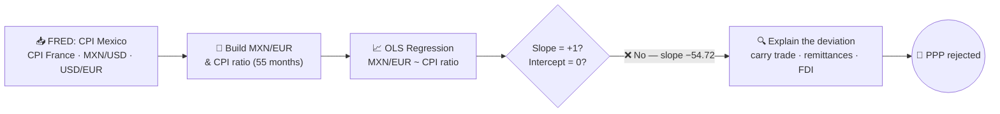

<div align="center">


# Does Purchasing Power Parity Hold for Mexico and France?

**Exchange Markets · Final Exam (Team 1)**
[](https://www.rennes-sb.com/)
**MSc International Business Management & Finance**

<p>
  
  
  
  
  
  
</p>

<h3>💭 Mexican inflation ran well above French inflation for five straight years —<br/>so why did the peso get <em>stronger</em>, not weaker, against the euro?</h3>

<sub>Purchasing Power Parity · OLS regression · FRED macro data · FX economics</sub>

</div>

---

## 📌 TL;DR

<div align="center">

| Does PPP hold? | Is the fit "good"? | What moved the peso? | Unique to this pair? |
|:---:|:---:|:---:|:---:|
| ❌ **No** — slope has the **wrong sign** (−54.72, not +1) | ⚠️ Deceptively — R²=0.66, F=101.8 (p<0.001) confirms the model, not the theory | 🏦 **Carry trade** (rates >11% vs. ~0%) + record remittances + nearshoring FDI | No — textbook case of PPP failing over short, shock-heavy windows |

</div>

---

## 📂 Contents

- [👥 Team 1](#-team-1)
- [❓ The Question](#-the-question)
- [🔄 Method Pipeline](#-method-pipeline)
- [📊 Data & Method](#-data--method)
- [📈 Results](#-results)
- [🔍 Why PPP Fails Here](#-why-ppp-fails-here)
- [🖼️ Visuals](#️-visuals)
- [✅ Conclusion](#-conclusion)
- [📁 Repo Contents](#-repo-contents)

---

## 👥 Team 1

<div align="center">

| Member | |
|---|:---:|
| **Carlos Alejandro Arroyo Cortés** | [](https://www.linkedin.com/in/carlos-arroyo-cortes/) |
| **Iñigo Ocampo de Vecchi** | [](https://www.linkedin.com/in/inigo-ocampo-de-vecchi/) |
| **Ludovic Delot Bravo** | [](https://www.linkedin.com/in/delot/) |
| **Miguel de Jesús Cárdenas Ochoa** | |

</div>

<sub>Home exam (Final Exam, 40% of the course grade) for **FI542E — Exchange Markets**, Dr. Taoufik Bouraoui.</sub>

---

## ❓ The Question

**Absolute Purchasing Power Parity (PPP)** predicts that a nominal exchange rate should equal the ratio of two countries' price levels — if Mexican prices rise 20% more than French prices, the peso/euro rate should reflect exactly that, no more, no less:

```
MXN/EUR = a × (CPI_Mexico / CPI_France) + b
```

Strict absolute PPP requires **a = 1** and **b = 0**. This project tests whether that holds for Mexico and France using real 2020–2024 data — and, more usefully, tries to explain *why* it doesn't.

## 🔄 Method Pipeline



## 📊 Data & Method

| | |
|---|---|
| 📅 **Period** | 55 monthly observations, January 2020 – July 2024 |
| 🌐 **Source** | FRED — Mexico CPI (`MEXCPIALLMINMEI`), France CPI (`FRACPIALLMINMEI`) |
| 💱 **FX construction** | MXN/EUR isn't published directly by FRED, so built as `MXN/USD (DEXMXUS) × USD/EUR (DEXUSEU)`, averaged daily → monthly to match CPI frequency |
| 📉 **Model** | Simple OLS of MXN/EUR on the CPI ratio (Mexico ÷ France), estimated via Excel's Data Analysis ToolPak |
| 💻 **Code** | Full download/build code (Python + `pandas_datareader`) is in the final exam PDF's appendix; dataset in [`data/ppp_mexico_france_monthly.csv`](data/ppp_mexico_france_monthly.csv) |

## 📈 Results

<div align="center">

| Statistic | Value |
|---|---|
| Multiple R | 0.8110 |
| R² | 0.6577 |
| Adjusted R² | 0.6512 |
| F-statistic | 101.83 (Significance F ≈ 0.0000) |
| **Intercept (b)** | **89.08** (t = 13.35, p < 0.001) — PPP requires 0 |
| **CPI ratio slope (a)** | **−54.72** (t = −10.09, p < 0.001) — PPP requires +1 |

</div>

Both coefficients are highly significant — the regression is a "good fit" in the narrow statistical sense. But the **sign is backwards**: PPP predicts that as Mexican prices rise faster than French prices, the peso should *weaken* (a positive slope). Instead, the fit says the opposite, and the massive intercept (89.08) shows the model is mostly explaining a level shift that has nothing to do with relative prices.

> 🚫 **Verdict: absolute PPP does not hold for Mexico and France over this period.**

## 🔍 Why PPP Fails Here

| Driver | Explanation |
|---|---|
| 🏦 **Carry trade** | Banco de México pushed rates above 11% post-COVID while the ECB held near-zero (negative deposit rate) until mid-2022. A 1,000+ bps spread made peso-denominated assets attractive regardless of inflation. |
| 💸 **Remittances** | Mexico received a record ~$64.7B in remittances in 2024 (Banco de México) — a steady, price-independent source of peso demand. |
| 🏭 **Nearshoring / FDI** | Post-2020 supply-chain reshoring pushed FDI into Mexican manufacturing — demand-side support unrelated to CPI. |
| 🛖 **Non-tradable goods** | Both CPIs (especially France's) are heavy with non-tradables (housing, healthcare, education), breaking the "law of one price" logic PPP relies on. |
| ⏳ **Short, shock-heavy sample** | 55 months packed with COVID, a global inflation surge, and a synchronized tightening cycle isn't the clean, long-horizon setting where PPP tends to show up empirically. |

## 🖼️ Visuals

<table>
<tr>
<td width="50%"><p align="center"><sub>Relative prices climb steadily while the peso does the opposite of what PPP predicts</sub></p></td>
<td width="50%"><p align="center"><sub>Actual MXN/EUR vs. the regression's fitted line</sub></p></td>
</tr>
</table>

## ✅ Conclusion

Absolute PPP is **rejected** for MXN/EUR over 2020–2024: the regression's statistical strength (R² = 0.66) is real, but it's explaining the wrong relationship — a negative, oversized slope instead of the theory's expected +1. The peso's actual behavior is better explained by capital flows (carry trade, remittances, nearshoring FDI) than by relative inflation.

> 💡 A useful reminder: a statistically significant regression is not the same as confirming the underlying economic theory — always check the sign and magnitude against what the model is supposed to predict, not just the p-value.

## 📁 Repo Contents

| File | Description |
|---|---|
| 📄 [`FinalExam_PPP_MexicoFrance_Team1.pdf`](FinalExam_PPP_MexicoFrance_Team1.pdf) | The team's submitted final exam — data description, model, regression output, interpretation, and the Python code + full dataset appendix |
| 📋 [`Assignment_Brief_Syllabus.pdf`](Assignment_Brief_Syllabus.pdf) | Official course syllabus (objectives, assessment weights, module plan) |
| 📊 [`data/ppp_mexico_france_monthly.csv`](data/ppp_mexico_france_monthly.csv) | The 55-month dataset (CPI Mexico, CPI France, MXN/EUR, CPI ratio) |
| 🖼️ `figures/` | Charts rendered from the dataset and regression coefficients |

---

<div align="center">

Uploaded by **[Ludovic Delot](https://www.linkedin.com/in/delot/)** [](https://www.linkedin.com/in/delot/)
MSc International Business Management & Finance · [Rennes School of Business](https://www.rennes-sb.com/)

</div>
