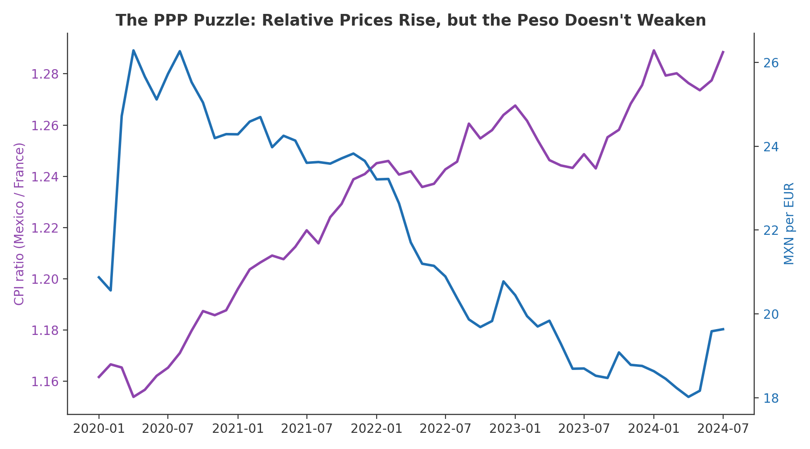
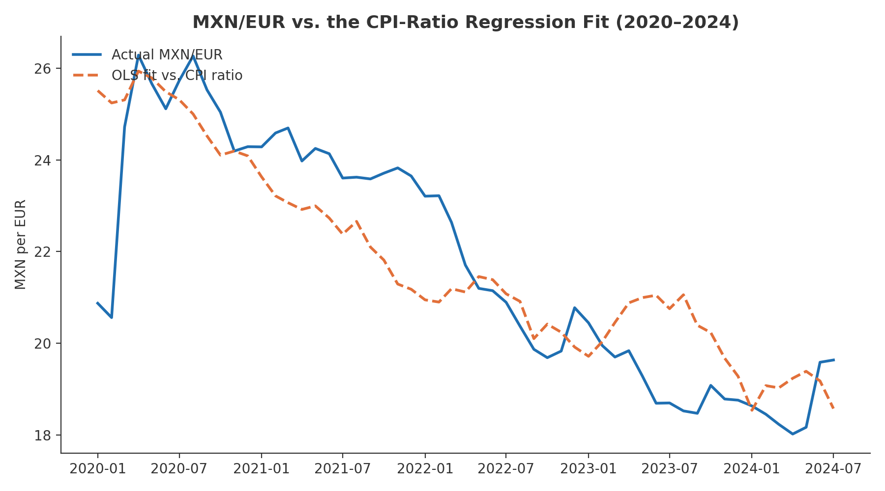

<div align="center">

# 💱 Does PPP Hold for Mexico and France?

### Exchange Markets — Final Exam (Team 1) · MSc International Business Management & Finance

<p>
  
  
  
</p>

<p>
  
  
  
  
</p>

**Mexican inflation ran well above French inflation for five straight years — so why did the peso get *stronger*, not weaker, against the euro?**
Purchasing Power Parity · OLS regression · FRED macro data · FX economics

</div>

---

## 📌 TL;DR

| Question | Answer |
|---|---|
| Does absolute PPP hold for MXN/EUR (2020–2024)? | ❌ **No** — the regression slope has the **wrong sign** (−54.72, not +1) |
| Is the fit "good" by textbook stats? | ⚠️ Deceptively yes — R² = 0.66, F = 101.8 (p < 0.001) — but a strong fit with the wrong sign confirms the model, not the theory |
| So what actually moved the peso? | 🏦 A **carry trade**: Mexican rates > 11% vs. near-zero ECB rates, plus record remittances (~$64.7B in 2024) and nearshoring FDI |
| Is this unique to Mexico/France? | No — it's a textbook case of why absolute PPP rarely holds over short, shock-heavy windows |

---

## 👥 Team 1

| Member | |
|---|---|
| **Carlos Alejandro Arroyo Cortés** | |
| **Iñigo Ocampo de Vecchi** | |
| **Ludovic Delot Bravo** | |
| **Miguel de Jesús Cárdenas Ochoa** | |

Home exam (Final Exam, 40% of the course grade) for **FI542E — Exchange Markets**, Dr. Taoufik Bouraoui.

## 📂 Table of Contents
1. [The question](#-the-question)
2. [Data & method](#-data--method)
3. [Results](#-results)
4. [Why PPP fails here](#-why-ppp-fails-here)
5. [Visuals](#️-visuals)
6. [Conclusion](#-conclusion)
7. [Repo contents](#-repo-contents)

---

## ❓ The question

**Absolute Purchasing Power Parity (PPP)** predicts that a nominal exchange rate should equal the ratio of two countries' price levels — if Mexican prices rise 20% more than French prices, the peso/euro rate should reflect exactly that, no more, no less:

```
MXN/EUR = a × (CPI_Mexico / CPI_France) + b
```

Strict absolute PPP requires **a = 1** and **b = 0**. This project tests whether that holds for Mexico and France using real 2020–2024 data — and, more usefully, tries to explain *why* it doesn't.

## 📊 Data & method

- **55 monthly observations**, January 2020 – July 2024, pulled from **FRED**.
- Mexico CPI (`MEXCPIALLMINMEI`) and France CPI (`FRACPIALLMINMEI`).
- MXN/EUR isn't published directly by FRED, so it was constructed as `MXN/USD (DEXMXUS) × USD/EUR (DEXUSEU)`, averaged from daily to monthly to match CPI frequency.
- Simple OLS regression of MXN/EUR on the CPI ratio (Mexico ÷ France), estimated via Excel's Data Analysis ToolPak.
- Full download/build code (Python + `pandas_datareader`) is in the final exam PDF's appendix; the resulting dataset is in [`data/ppp_mexico_france_monthly.csv`](data/ppp_mexico_france_monthly.csv).

## 📈 Results

| Statistic | Value |
|---|---|
| Multiple R | 0.8110 |
| R² | 0.6577 |
| Adjusted R² | 0.6512 |
| F-statistic | 101.83 (Significance F ≈ 0.0000) |
| **Intercept (b)** | **89.08** (t = 13.35, p < 0.001) — PPP requires 0 |
| **CPI ratio slope (a)** | **−54.72** (t = −10.09, p < 0.001) — PPP requires +1 |

Both coefficients are highly significant — the regression is a "good fit" in the narrow statistical sense. But the **sign is backwards**: PPP predicts that as Mexican prices rise faster than French prices, the peso should *weaken* (a positive slope). Instead, the fit says the opposite, and the massive intercept (89.08) shows the model is mostly explaining a level shift that has nothing to do with relative prices.

**Verdict: absolute PPP does not hold for Mexico and France over this period.**

## 🔍 Why PPP fails here

- **Interest rate differential / carry trade** — Banco de México pushed rates above 11% post-COVID while the ECB held near-zero (negative deposit rate) until mid-2022. A 1,000+ bps spread made peso-denominated assets attractive regardless of inflation, propping up the currency.
- **Remittances** — Mexico received a record ~$64.7B in remittances in 2024 (Banco de México), a steady, price-independent source of peso demand.
- **Nearshoring / FDI** — post-2020 supply-chain reshoring pushed FDI into Mexican manufacturing, another demand-side support for the peso unrelated to CPI.
- **Non-tradable goods in the CPI basket** — both countries' CPIs (especially France's) are heavy with non-tradables (housing, healthcare, education) whose price gaps can't be arbitraged away through trade, breaking the "law of one price" logic PPP relies on.
- **Short, shock-heavy sample** — 55 months packed with COVID, a global inflation surge, and a synchronized tightening cycle is not the clean, long-horizon setting where PPP tends to show up empirically.

## 🖼️ Visuals

<table>
<tr>
<td width="50%"><p align="center"><sub>Relative prices climb steadily while the peso does the opposite of what PPP predicts</sub></p></td>
<td width="50%"><p align="center"><sub>Actual MXN/EUR vs. the regression's fitted line</sub></p></td>
</tr>
</table>

## ✅ Conclusion

Absolute PPP is **rejected** for MXN/EUR over 2020–2024: the regression's statistical strength (R² = 0.66) is real, but it's explaining the wrong relationship — a negative, oversized slope instead of the theory's expected +1. The peso's actual behavior is better explained by capital flows (carry trade, remittances, nearshoring FDI) than by relative inflation. This is a useful reminder that a statistically significant regression is not the same as confirming the underlying economic theory — always check the sign and magnitude against what the model is supposed to predict, not just the p-value.

## 📁 Repo contents

| File | Description |
|---|---|
| [`FinalExam_PPP_MexicoFrance_Team1.pdf`](FinalExam_PPP_MexicoFrance_Team1.pdf) | The team's submitted final exam — data description, model, regression output, interpretation, and the Python code + full dataset appendix |
| [`Assignment_Brief_Syllabus.pdf`](Assignment_Brief_Syllabus.pdf) | Official course syllabus (objectives, assessment weights, module plan) |
| [`data/ppp_mexico_france_monthly.csv`](data/ppp_mexico_france_monthly.csv) | The 55-month dataset (CPI Mexico, CPI France, MXN/EUR, CPI ratio) |
| `figures/` | Charts rendered from the dataset and regression coefficients |

---

<div align="center">

**Uploaded by:** [Ludovic Delot](https://github.com/ludodelot) — MSc International Business Management & Finance, Rennes School of Business

</div>
